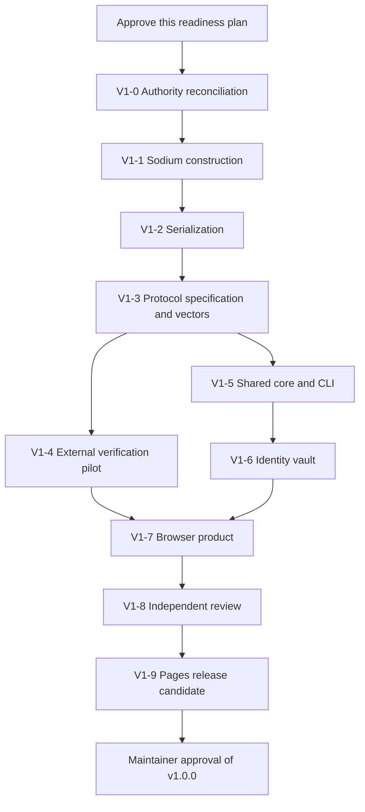

# CipherBook v1 Readiness Plan

> [!CAUTION]
> **Status: readiness roadmap approved by the maintainer on 2026-07-24. The
> maintainer later overrode sequential milestone approvals and authorized all
> technically performable work, including a GitHub Pages preview.**
>
> The current CipherBook Alpha remains an experimental engineering preview.
> Do not use it for real secrets. Approval of this roadmap does not define
> protocol bytes or establish representative human evidence or independent
> review. Any early hosted preview must disclose those absences and remain
> unsuitable for real secrets.

- Approved as roadmap: 2026-07-24
- Repository baseline: `8fb95eb3fff73c54de0c523dd70d5b810190962c`
- Authority: maintainer's "CipherBook v1 Direction Handoff"
- Immediate authorized scope: technical milestones and an honestly labeled
  Pages preview; missing human and independent evidence cannot be waived as fact

## 1. Executive outcome

The handoff supplies enough product direction to replace the Alpha-only roadmap,
but not enough protocol evidence to implement or publish v1.

The correct next step is an explicit sequence of separately reviewed milestones:

1. reconcile and supersede the Alpha-only authority;
2. compare two sodium sign-and-encrypt constructions;
3. compare deterministic CBOR and canonical JSON;
4. specify and approve protocol v1 and fixed test vectors;
5. run the external verification pilot;
6. implement the shared protocol core and reference CLI;
7. design and implement the two-key encrypted identity vault and lock behavior;
8. implement and polish the browser product;
9. obtain independent review and remediate findings; and
10. publish and verify a release candidate before approving `v1.0.0`.

No current Alpha contact, envelope, relationship-digest, or identity-file byte
is promoted by this plan.

## 2. Evidence categories

### Facts

- The current Alpha uses one static sodium `crypto_box` key pair for identity,
  recipient-local authentication, an unstable JSON envelope, a full hexadecimal
  relationship display, and a 16-emoji convenience display.
- The current Alpha identity file encrypts only one 32-byte `crypto_box` private
  key. It cannot represent the approved separate encryption and signing
  identities.
- The current Alpha does not persist contacts or verification state, does not
  automatically lock an encrypted local vault, has no stable protocol, and is
  not deployed.
- Milestone 1 demonstrated recipient forgeability in the existing static
  `crypto_box` relationship construction and the lack of native sender
  authentication in the age candidate.
- Milestone 2A demonstrated synthetic Node/browser behavior in Chromium and
  Firefox. It did not produce representative human evidence.
- The Milestone 2B pilot was not run. The maintainer is not an independent or
  representative substitute for the required external participants.
- The repository is public and Apache-2.0 licensed, but GitHub Pages is not
  enabled.
- Libsodium sealed boxes use an ephemeral sender key and authenticate ciphertext
  integrity for the recipient, but do not identify the sender. Libsodium
  signatures are a separate public-verification mechanism. See the official
  [sealed-box](https://doc.libsodium.org/public-key_cryptography/sealed_boxes)
  and
  [signature](https://doc.libsodium.org/public-key_cryptography/public-key_signatures)
  documentation.

### Approved product directions

The maintainer has approved these directions as inputs to this plan:

- CipherBook remains the project name.
- The v1 construction family will use maintained high-level libsodium
  operations.
- Sender authentication will use a separate transferable signing identity.
- Public contacts will contain logically separate encryption and signing public
  keys.
- The sender's signature will be inside the encrypted content and will bind the
  protocol domain, version, sender, intended recipient, and payload.
- CipherBook will use a compact custom envelope, subject to an approved
  specification and evidence that the format remains necessary.
- Verification will be layered: complete contact or relationship data in QR,
  full grouped hexadecimal as the exact manual/accessibility fallback, and 16
  numbered, spoken-label emojis as a public convenience representation.
- Imported contacts start unverified, can be pinned only after a separate
  trusted interaction, and require complete reverification after a key change.
- Stable identities, explicit temporary identities, immediate locking, and
  inactivity locking are product requirements.
- GitHub Pages is the intended initial host.
- `v1.0.0` will mean a compatibility commitment, not absence of security
  limitations.

### Recommendations in this draft

These are recommendations, not approved protocol or implementation decisions:

- Preserve the existing `experiments/` and `alpha/` directories as historical
  evidence; build v1 in new directories after protocol approval.
- Keep the protocol codec, sodium adapter, vault, CLI, and browser UI as
  independently testable modules.
- Retain npm and a lockfile unless a milestone finds a concrete reason to
  migrate.
- Use strict TypeScript for new v1 protocol and application modules, subject to
  an explicit tooling decision before implementation.
- Require the external human pilot rather than using the handoff's
  "pilot skipped" escape for a release that removes experimental warnings.
- Do not migrate Alpha identities or contacts into v1. Alpha material is
  synthetic and disposable; migration adds dangerous compatibility surface
  without user value.
- Treat the initial v1 as one sender, one recipient, one active local identity,
  plain text only, with no message history.

### Assumptions requiring validation

- Transferable signatures match the intended attribution use case better than
  recipient-local authentication despite their disclosure and dispute
  consequences.
- Users understand that a verified signing key is not proof of a person's
  physical or legal identity.
- A custom envelope supplies enough value to justify its parser and
  compatibility surface.
- A two-key contact remains usable in text and QR exchange.
- At least one serialization candidate can reject ambiguous input consistently
  in the browser, CLI, and an independent verifier.
- Sixteen emojis help comparison without causing users to skip the complete
  verification flow.
- A solo maintainer can support the vault, browser, CLI, protocol,
  dependencies, vulnerability handling, and hosted release process.

## 3. Conflicts with current authority and implementation

| New direction                         | Existing Alpha authority or behavior                                                       | Required resolution                                                                                |
| ------------------------------------- | ------------------------------------------------------------------------------------------ | -------------------------------------------------------------------------------------------------- |
| Libsodium is the v1 family            | Project-level construction decision #1 is unresolved; sodium is authorized only for Alpha  | Accept a direction-and-supersession record while leaving the exact sodium construction pending     |
| Transferable signatures               | Alpha uses recipient-local, deniable, recipient-forgeable `crypto_box` authentication      | Compare and approve a sign-and-encrypt construction; replace all sender-semantics copy and tests   |
| Separate signing key                  | Alpha contacts and identity files contain one encryption key pair                          | Define a new contact and a new encrypted identity format; do not relabel Alpha bytes               |
| Custom compact envelope               | Alpha uses unstable six-field JSON and expressly denies compatibility                      | Specify a new strict format after the serialization comparison; freeze only approved bytes         |
| QR, full hex, and 16 emojis           | Alpha authorizes full hex plus unvalidated emojis; it has no product contact-QR flow       | Run the external pilot and approve the final authorization flow and QR reciprocity behavior        |
| Pinned verified contacts              | Alpha intentionally restores no contacts or trust state                                    | Design encrypted contact/trust persistence, stale-contact behavior, rotation, and reverification   |
| Stable identity and automatic lock    | Alpha is memory-first with manual identity-file import/export and no automatic local vault | Select a v1 vault, KDF profile, storage location, timeout, and recovery behavior                   |
| GitHub Pages                          | Alpha is expressly local-only and undeployed                                               | Approve hosted-code controls and release engineering after implementation review                   |
| Protocol v1                           | Decision #9 is unresolved and all existing encodings are disposable                        | Approve a normative specification and vectors before product implementation                        |
| Finished v1 wording                   | Current copy must describe Alpha accurately                                                | Change labels only after all release gates pass; permanent limitations remain visible              |
| Suitability for sensitive information | No independent review or representative pilot exists                                       | Obtain scoped independent review and complete the pilot before making any narrow suitability claim |
| Full PWA/offline behavior             | Current authority forbids a service worker and the handoff does not approve one            | Keep PWA installation and service-worker caching out of v1 unless separately approved              |

The new direction does not erase the Alpha record. It creates a new line of work
whose accepted decisions supersede Alpha constraints only for new v1
directories. Historical Alpha files and tags remain labeled as Alpha.

## 4. Product decisions versus protocol details

| Area                  | Approved product direction                                    | Still requires evidence and explicit approval                                                                 |
| --------------------- | ------------------------------------------------------------- | ------------------------------------------------------------------------------------------------------------- |
| Crypto family         | High-level libsodium                                          | Sealed box plus inner signature versus static `crypto_box` plus inner signature; exact APIs and failure order |
| Sender authentication | Transferable signature with a separate signing key            | Exact signature input bytes, key encoding, verification order, and transcript export behavior                 |
| Envelope              | Compact custom CipherBook envelope                            | Schema, field identifiers, serialization, text marker, text armor, maximum size, extensions                   |
| Verification          | Full QR data, grouped hex fallback, 16-emoji convenience      | Relationship-digest bytes, ordering, emoji alphabet mapping, authorization UI, QR reciprocity                 |
| Contacts              | Imported contacts unverified; pin after separate verification | Contact identifier, alias handling, persistence, reminder behavior, rotation and revocation                   |
| Identity              | Stable and temporary modes; lock now and inactivity lock      | Encrypted vault format, KDF, browser storage, recovery export, timeout, migration policy                      |
| Hosting               | GitHub Pages                                                  | Workflow, environment reviewers, artifact provenance, CSP limits, rollback and update policy                  |
| Version               | v1 is a compatibility promise                                 | Every v1 byte, version-dispatch rule, compatibility window, replay behavior and error taxonomy                |

## 5. Minimum decision records

The following records are the minimum needed to supersede the Alpha-only
constraints without hiding unresolved details. Each record must use one of
`proposed`, `accepted`, `rejected`, or `superseded` and identify its approving
human and date.

### V1-0001: Direction, boundaries, and Alpha supersession

Records the approved product directions, permanent security boundaries, v1
scope, historical status of Alpha artifacts, and milestone-by-milestone
authorization rule.

Acceptance of V1-0001 authorizes only the next named evidence milestone. It does
not approve protocol bytes or deployment.

### V1-0002: Sodium sign-and-encrypt construction

Records the comparison evidence, selected construction, precise sender and
recipient semantics, compromise consequences, rejected candidate, and
conditions that would reopen the decision.

### V1-0003: Serialization and strict-decoding profile

Records the CBOR/JSON measurements, selected profile, duplicate and malformed
input rules, deterministic-encoding rule, text armor, dependency decision, and
independent-implementation result.

### V1-0004: Protocol v1 specification and compatibility policy

Approves the normative specification and immutable test-vector set by content
hash. Defines how incompatible changes become a new protocol version.

### V1-0005: Verification, contact trust, and key-change flow

Records pilot evidence, final fingerprint authorization behavior, QR
reciprocity, pinning, verification date, reminders, key changes, revocation, and
accessibility fallbacks.

### V1-0006: Encrypted identity vault, lock, and recovery

Records the two-key private identity representation, KDF and AEAD profiles,
persistent storage choice, inactivity timeout, immediate lock, recovery export,
atomic import, device-loss behavior, and explicit Alpha non-migration policy.

### V1-0007: Hosted release and update policy

Records the Pages workflow, manual approval model, permitted production source,
artifact verification, rollback, version/commit display, host-metadata
disclosure, and release-claims checklist.

### V1-0008: v1 release approval

Links the accepted records, independent review report, remediations, pilot
result, CI run, release-candidate artifact hash, deployed verification result,
known limitations, and maintainer's final approval.

## 6. Security boundaries that remain after v1

The final interface and documentation must continue to state that CipherBook
does not provide:

- anonymity or transport-metadata hiding;
- protection from compromised endpoints, browsers, extensions, operating
  systems, keyboards, displays, or clipboards;
- enforced deletion, expiration, recall, or recipient restraint;
- censorship resistance;
- guaranteed memory erasure;
- protection when both contact exchange and verification are attacker
  controlled; or
- forward secrecy unless the selected construction is independently shown to
  provide it.

A transferable signature proves control of a verified signing key over the
specified signed bytes. It does not prove a person's physical identity,
truthfulness, intent, authority, or exclusive control of the key.

The release must distinguish:

- application telemetry, which should remain absent;
- runtime third-party resources, which are prohibited; and
- normal GitHub Pages hosting metadata, which GitHub may collect.

## 7. Recommended v1 architecture

This structure is a recommendation for the implementation milestones, not
authorization to create it now:

```text
protocol/
  v1/
    SPEC.md
    SECURITY.md
    vectors/
packages/
  codec/
  protocol-core/
  sodium-adapter/
  identity-vault/
apps/
  cli/
  web/
studies/
  v1-verification/
docs/
  decisions/
  release/
```

Required boundaries:

- `codec` performs bounded strict parsing and deterministic serialization. It
  contains no cryptography, DOM, filesystem, or storage behavior.
- `protocol-core` defines typed protocol values, domain-separated signature
  input, validation, contact identifiers, relationship digest, and seal/open
  orchestration through injected adapters.
- `sodium-adapter` is the only package that calls libsodium. It uses approved
  high-level operations and owns key generation, signature, encryption,
  decryption, and best-effort buffer disposal.
- `identity-vault` owns private-key-at-rest protection and lock state. It is not
  imported by the codec or protocol specification tooling.
- `cli` and `web` consume the same core and vector set. Neither may implement a
  second codec or signature-input builder.
- Browser presentation, clipboard, QR camera, and IndexedDB code, if approved,
  remain outside protocol packages.
- The normative specification and vectors are readable without the JavaScript
  implementation so another language can interoperate.

The current `experiments/` and `alpha/` trees remain frozen except for factual
historical documentation or security fixes explicitly approved for those
artifacts.

## 8. Milestones

### Milestone V1-0: Authority reconciliation

#### Purpose

Create the governance boundary that permits evidence gathering without
silently treating Alpha as v1.

#### Dependencies

- Maintainer approval of this readiness plan.

#### Deliverables

- `docs/decisions/V1-0001-direction-and-supersession.md`
- Updates to `AGENTS.md`
- Updates to `docs/THREAT_MODEL.md`
- Updates to `docs/LIMITATIONS.md`
- Updates to `docs/UNRESOLVED_DECISIONS.md`
- A decision index if more than the existing directory listing is needed

#### Objective acceptance criteria

- Every handoff direction is classified as approved product direction,
  recommendation, assumption, or unresolved protocol detail.
- Alpha decisions remain intact as historical records.
- The new authority explicitly permits only one next milestone at a time.
- All permanent security boundaries in section 6 appear in the threat model and
  limitations.
- The unresolved-decision log distinguishes direction-level resolutions from
  evidence still required before bytes are selected.
- No application, dependency, protocol byte, release label, CI, Pages, or
  hosting setting changes.

#### Tests and review

- Diff review limited to governing documentation.
- Search for accidental claims of anonymity, metadata hiding, endpoint
  protection, forward secrecy, independent review, or suitability for real
  secrets.
- Search for accidental promotion of Alpha encodings or the Alpha identity
  file.

#### Explicit exclusions

All executable code, package changes, protocol schemas, vectors, UI changes,
release labels, GitHub settings, and deployment.

#### Security questions

- Which Alpha constraints are historical, and which limitations remain
  permanently applicable?
- What exact evidence is required before each later milestone may begin?

#### Stop conditions

- The maintainer will not retain the permanent limitations.
- The direction record is interpreted as approval of current Alpha bytes.
- Later milestones are authorized as an undifferentiated "fix everything"
  change without separate review points.

#### Review checkpoint

The maintainer accepts V1-0001 and separately authorizes Milestone V1-1.

### Milestone V1-1: Sodium construction comparison

#### Purpose

Select the smallest high-level sodium construction that supplies recipient
confidentiality, tamper rejection, and the approved transferable signature
semantics.

#### Candidates

1. Sign the inner protocol content, then encrypt it with
   `crypto_box_seal`.
2. Sign the inner protocol content, then encrypt it with static
   `crypto_box_easy`.

No other construction enters the spike without a revised decision record.

#### Likely files

- `experiments/v1-construction/README.md`
- `experiments/v1-construction/RESULTS.md`
- Minimal candidate adapters and synthetic-only tests under that directory
- `docs/decisions/V1-0002-sodium-construction.md`

These are disposable evidence files, not production packages.

#### Objective acceptance criteria

- Both candidates use the same synthetic inner-message model and the same
  generated encryption and signing identities.
- Both run in the supported Node test runtime and current Playwright Chromium
  and Firefox.
- Round trips pass for empty, ASCII, multiline, and Unicode payloads at fixed
  measured sizes.
- A changed signature, signed field, ciphertext byte, sender identifier,
  recipient identifier, or protocol-domain value never yields accepted
  plaintext.
- Wrong recipient, wrong expected signer, outsider signing key, truncation, and
  trailing-data cases fail closed.
- A recipient cannot create a new payload accepted under the sender's signing
  key without that signing key. Recipient replay and disclosure of a valid
  signed payload are demonstrated and documented as permitted consequences.
- Re-encryption of a copied signed payload to a different recipient fails
  because the signature binds the intended recipient.
- The report separately analyzes compromise of the sender encryption key,
  sender signing key, recipient encryption key, and combinations of those keys
  for past and future envelopes.
- The report states whether either candidate provides forward secrecy. No such
  claim is inferred from ephemeral sealed-box sender keys.
- Raw cryptographic overhead, complete candidate-envelope overhead, browser
  bundle impact, custom source surface, dependency surface, and failure order
  are measured for common payload sizes.
- The static-box candidate justifies any redundant recipient-local
  authentication added on top of the transferable signature.
- The sealed-box candidate documents that sender identity comes only from the
  inner verified signature.
- No low-level sodium primitive is composed to reproduce or alter a sealed box.
- An adversarial review checklist is completed before V1-0002 is accepted.

#### Required tests

- Known fixed key/signature verification fixtures.
- Randomized round trips.
- Tamper matrix over every signed field and outer routing field.
- Wrong-key and wrong-identifier matrix.
- Recipient replay and re-encryption probes.
- Outsider and recipient forgery probes.
- Later-key-compromise probes.
- Input size and resource-limit probes.
- Cross-runtime output/open tests.

For sealed boxes, a fixed captured ciphertext may be a known-answer open vector;
the production encryption call is randomized and need not reproduce the same
ciphertext. The spike must not implement a deterministic sealed box from
lower-level primitives.

#### Explicit exclusions

Serialization selection, production envelope fields, vault storage, final
fingerprint bytes, UI polish, contact persistence, deployment, and v1 labels.

#### Stop conditions

- Either candidate requires custom low-level cryptography.
- Signature verification or encryption failure order cannot be specified
  without dangerous ambiguity.
- Key-compromise behavior contradicts the intended use.
- Transferable-signature consequences cannot be explained plainly.

#### Review checkpoint

Accept V1-0002 with one selected candidate and authorize V1-2.

### Milestone V1-2: Serialization and strict-decoding comparison

#### Purpose

Select a deterministic, bounded, independently implementable representation
without choosing it merely for compactness or familiarity.

#### Candidates

1. RFC 8949 deterministic CBOR plus Base64url text armor.
2. RFC 8785 JSON Canonicalization Scheme with Base64url binary fields.

RFC 8949 warns that generic CBOR decoders may collapse duplicate map keys;
duplicate rejection therefore requires explicit evidence. RFC 8785 supplies
canonical JSON serialization but does not make a generic JavaScript parser
report duplicate input names.

#### Likely files

- `experiments/v1-serialization/README.md`
- `experiments/v1-serialization/RESULTS.md`
- Candidate codec adapters and hostile-input tests
- An independent minimal verifier or fixture consumer in a second runtime
- `docs/decisions/V1-0003-serialization.md`

#### Objective acceptance criteria

- The comparison uses one schema-neutral contact fixture and one
  envelope-shaped fixture; neither is called protocol v1.
- Browser and Node encoders produce byte-identical deterministic output for
  each candidate.
- A second implementation parses the same valid fixtures and rejects the same
  prohibited fixtures.
- Duplicate fields are rejected before they can be collapsed by a generic
  decoder, including escaped-equivalent JSON property names where applicable.
- Decoders reject trailing bytes/text, truncation, excessive nesting,
  indefinite or non-deterministic forms where prohibited, unsupported tags,
  disallowed numeric forms, invalid UTF-8, malformed Base64url, and inputs over
  fixed pre-parse limits.
- Unknown fields and unknown versions follow an explicit test policy rather
  than being silently ignored.
- Deterministic signing bytes can be produced without relying on host object
  insertion order.
- Size is measured for contacts, signatures, fixed payload sizes, complete text
  armor, and representative QR encodings.
- Runtime and development dependency trees, release activity, parser API,
  bundle contribution, and custom validation code are recorded.
- Human-readable vector diagnostics remain available even if the selected wire
  format is binary.
- V1-0003 states why the rejected candidate is not selected and lists any
  decoder behaviors that must be locked by tests.

#### Required tests

- Determinism and cross-runtime equality.
- Duplicate, reordered, unknown, missing, and wrong-type fields.
- Non-minimal values and non-deterministic encodings.
- Invalid Unicode and binary lengths.
- Nesting, allocation, and oversized-input limits.
- Base64url alphabet, padding, whitespace, and trailing-data cases.
- QR-size comparison at the same error-correction settings.
- Independent verifier agreement.

#### Explicit exclusions

Final field names/numbers, protocol tags, signature-domain bytes, production
dependencies, app code, vaults, and deployment.

#### Stop conditions

- A parser cannot expose or reject duplicates reliably.
- Deterministic output differs across browser, Node, and the verifier.
- Compactness requires a decoder surface unreasonable for a solo maintainer.

#### Review checkpoint

Accept V1-0003 and authorize V1-3.

### Milestone V1-3: Normative protocol v1 and test vectors

#### Purpose

Freeze the meaning and bytes before the product implementation is written.

#### Dependencies

- Accepted V1-0002 and V1-0003.
- A provisional V1-0005 contact-verification model sufficient to define contact
  and relationship inputs.

#### Likely files

- `protocol/v1/SPEC.md`
- `protocol/v1/SECURITY.md`
- `protocol/v1/vectors/README.md`
- Machine-readable vector manifests and immutable binary/text artifacts
- An independent vector verifier outside the main protocol package
- `docs/decisions/V1-0004-protocol-v1.md`

#### Normative specification requirements

The specification must define:

- public-contact fields and exact key encodings;
- separation of encryption and signing key types;
- contact identifiers and collision handling;
- relationship-digest inputs, domain separation, and canonical ordering;
- signed-content fields and exact signature input;
- public routing metadata, encrypted fields, authenticated relationships
  between outer and inner fields, and privacy consequences;
- sender and recipient identifiers;
- selected serialization restrictions;
- text armor and short neutral paste-recognition marker;
- one compact ASCII block with no `BEGIN`/`END` wrapper and no requirement for
  the CipherBook name to appear in transported text;
- QR payloads and maximum QR size;
- payload, contact, envelope, nesting, and decoded-byte limits;
- version dispatch, unknown-version rejection, and extension policy;
- replay behavior and any local duplicate warning;
- error categories and what is exposed to users;
- key creation, rotation, compromise, revocation, and reverification;
- behavior for envelopes addressed to old keys;
- compatibility policy and the conditions requiring protocol v2; and
- explicit absence or presence of forward secrecy.

#### Vector requirements

- Fixed key material generated solely for published vectors.
- Contact encodings and identifiers.
- Relationship digest and every displayed representation.
- Exact pre-signature bytes and expected signature.
- Exact serialized inner content.
- At least one fixed valid encrypted envelope per construction path selected by
  V1-0002.
- Valid open results.
- Tampered signature, ciphertext, routing identifiers, and payload.
- Wrong recipient and wrong sender key.
- Truncated, oversized, duplicate, malformed, trailing, and unknown-version
  artifacts.
- Expected error category for every invalid vector.
- A manifest hash covering the complete vector set.

No vector private key may be accepted by the production UI or confused with a
user identity. Tests must visibly label all vector keys as public test material.

#### Objective acceptance criteria

- The specification contains no unresolved normative `TODO`, "implementation
  defined", or accidental Alpha reference.
- Every field is classified as public, encrypted, signed, authenticated by
  encryption, optional, or extensible.
- Every parser limit is numeric and every length unit is explicit.
- The signature and relationship domains cannot be confused with each other or
  with Alpha artifacts.
- Browser/CLI implementers can derive the same result using only the
  specification and vectors.
- The independent verifier passes all valid vectors and rejects every invalid
  vector with the specified category.
- An adversarial reviewer signs off on the construction, downgrade handling,
  parser rules, signature binding, replay statement, and compromise analysis.
- The maintainer approves the exact vector manifest hash in V1-0004 before
  implementation begins.

#### Explicit exclusions

Product UI, persistent storage, Pages, release labels, compatibility migration,
multiple devices, groups, attachments, and message history.

#### Stop conditions

- Correct behavior depends on undocumented library defaults.
- There is no independent agreement on bytes.
- Replay, rotation, or error behavior remains ambiguous.
- A custom format is no longer justified by the selected requirements.

#### Review checkpoint

Accept V1-0004 by exact specification commit and vector-manifest hash, then
authorize V1-4 and V1-5.

### Milestone V1-4: External verification pilot

#### Purpose

Determine whether representative people perform the layered contact
verification correctly and understand transferable signatures.

#### Dependencies

- Approved study protocol and consent script.
- Stable synthetic contact and fingerprint fixtures derived from the protocol
  candidate.
- A two-device QR flow suitable for observation.

#### Likely files

- `studies/v1-verification/README.md`
- `studies/v1-verification/STUDY_PROTOCOL.md`
- `studies/v1-verification/CONSENT_SCRIPT.md`
- `studies/v1-verification/RESULTS_TEMPLATE.md`
- A synthetic local study harness and tests
- De-identified aggregate results only
- `docs/decisions/V1-0005-verification-and-contact-trust.md`

Raw names, contact details, recordings, and private participant information must
not be committed.

#### Participant requirements

- At least six representative external participants.
- The maintainer may moderate and dogfood but is not counted among the six.
- Participants use only synthetic contacts and payloads.
- The sample should include the device, language, and accessibility conditions
  for which v1 claims are intended. Missing coverage is disclosed.

#### Required observations

- In-person QR exchange in both directions.
- Copy/paste contact import followed by a genuinely separate verification
  interaction.
- Full grouped hexadecimal comparison.
- Sixteen numbered emojis with spoken labels.
- Seeded differences at the beginning, middle, and end.
- Unexpected key-change and reverification behavior.
- Explanation of what the signature proves and why the recipient can reveal it
  to others.
- Explanation that fingerprints and public contacts are public, not passwords
  or encryption keys.
- Completion time, skipped positions, requests for help, rendering and
  accessibility problems, and preference versus the participant's existing
  tool.

#### Objective acceptance criteria

- Zero false acceptance of seeded fingerprint or key-change mismatches.
- At least five of six participants complete contact exchange, verification,
  seal, transport, and open without a critical mistake.
- Every participant states that the fingerprint is public and not an encryption
  secret.
- Every participant explains that a valid signature is associated with the
  verified signing key, is revealable to others, and is not proof of physical
  identity or truthfulness.
- Observation notes distinguish fact from moderator interpretation.
- The final authorization flow does not permit 16 emojis alone to override a
  full-data mismatch.
- V1-0005 records verification date, pinning, key-change, reminder, QR
  reciprocity, manual fallback, and accessibility behavior.

If these criteria fail, the milestone does not pass by changing copy after the
fact. The design is revised and the affected tasks are rerun with new
participants.

#### Explicit exclusions

Real secrets, remote participant surveillance, statistical market claims,
automatic contact discovery, accounts, sync, and production deployment.

#### Stop conditions

- Any seeded mismatch is falsely accepted.
- Participants routinely treat the fingerprint as secret.
- Transferable signatures create material false beliefs.
- QR or manual verification excludes intended users without a workable
  fallback.
- Participants prefer established tools for the target scenario.

#### Review checkpoint

Accept V1-0005 or redesign/archive the project.

### Milestone V1-5: Shared protocol core and reference CLI

#### Purpose

Implement the approved bytes once, with the CLI as the first complete reference
consumer.

#### Dependencies

- Accepted V1-0002, V1-0003, and V1-0004.

#### Likely files

- `packages/codec/`
- `packages/protocol-core/`
- `packages/sodium-adapter/`
- `apps/cli/`
- Shared vector, unit, property, and malformed-input tests
- Updated package metadata and lockfile

#### Objective acceptance criteria

- The implementation matches every valid and invalid v1 vector.
- The CLI and independent verifier agree on contacts, identifiers,
  fingerprints, signatures, and envelopes.
- Seal/open uses only the selected high-level sodium operations.
- Contacts and envelopes are bounded before expensive work.
- Duplicate, trailing, unknown-version, malformed, wrong-key, tampered, and
  oversized inputs fail closed.
- Signature verification binds every required context field and cannot be
  bypassed through outer/inner disagreement.
- Random production keys and nonces come only from the approved sodium random
  interface.
- Fixed vector randomness cannot be reached from production command paths.
- Secret or plaintext values are not logged, included in thrown diagnostics, or
  stored in test snapshots.
- CLI output distinguishes verification of a signing key from proof of a person.
- Dependency inventory and license review are complete.
- Unit, known-answer, round-trip, tamper, property, fuzz or structured
  malformed-input, and interoperability tests pass.

#### CLI scope

- Generate a temporary v1 identity for vector and interoperability work.
- Export a public contact.
- Inspect and compare public contact information.
- Seal one plain-text payload.
- Open one plain-text envelope.
- Report version and source commit.

Persistent identity, recovery, rotation, and vault commands enter only after
V1-0006 approves their behavior.

#### Explicit exclusions

Browser UI, QR camera, Pages, groups, attachments, accounts, delivery, chat
history, and unsupported migration.

#### Stop conditions

- The implementation needs behavior absent from the specification.
- CLI and independent verifier disagree.
- A high-impact parser or cryptographic failure remains unresolved.

#### Review checkpoint

Approve the shared core/CLI implementation commit and authorize V1-6.

### Milestone V1-6: Encrypted identity vault and lock behavior

#### Purpose

Protect the separate encryption and signing private identities at rest, support
stable and temporary identity modes, and define loss/recovery behavior.

#### Dependencies

- Accepted protocol contact/key model.
- Accepted V1-0006 design before implementation.

#### Required design comparison

The decision record must compare at least:

- an opt-in IndexedDB encrypted vault plus encrypted recovery export; and
- a file-mediated stable identity that avoids automatic browser persistence.

It must explain which encrypted material remains after lock, what survives
reload, and what the browser cannot erase.

#### Likely files

- `docs/decisions/V1-0006-identity-vault-lock-recovery.md`
- `packages/identity-vault/`
- Browser storage adapter under `apps/web/`
- Vault vectors and hostile-file fixtures
- Lock, lifecycle, KDF, import/export, and cross-browser tests

#### Objective acceptance criteria

- The new format stores the approved encryption and signing private identities
  and cannot be confused with the 107-byte Alpha identity file.
- No private key or passphrase is intentionally stored unencrypted.
- File/storage size, magic, version, and fixed local KDF profile are validated
  before expensive KDF work.
- Input cannot select KDF cost.
- Import is atomic: failure leaves the active identity unchanged.
- Immediate lock and inactivity lock remove decrypted private-key references
  and passphrase controls from page-managed state on a best-effort basis.
- Backgrounding, page lifecycle, back/forward cache, system clock changes, and
  concurrent-tab behavior have defined tests.
- A longer unlocked session is explicit, time-bounded, and visibly warned.
- Temporary mode writes no identity material to persistent browser storage.
- Recovery export/import restores both key pairs and the same public contact, or
  the design explicitly chooses another reviewed result.
- Loss of the encrypted material or passphrase has an unambiguous, irreversible
  user-facing result.
- Offline passphrase guessing, copied files, browser extensions, OS backups, and
  memory limitations are disclosed.
- The default timeout is selected from observation, not maintainer preference
  alone.
- Alpha identities are rejected rather than migrated unless a separate
  migration decision is approved.

#### Required tests

- Correct-passphrase and wrong-passphrase behavior.
- Tamper, truncation, trailing, wrong-profile, oversized, and hostile KDF input.
- Atomic replacement and failure preservation.
- Immediate and timed lock using monotonic elapsed-time behavior where
  available.
- Reload, browser restart, background, back/forward cache, and multi-tab cases.
- Temporary-mode storage inspection.
- Chromium and Firefox real-profile KDF allocation and timing.
- Recovery round trip for both key identities.

#### Explicit exclusions

Accounts, cloud sync, password reset, managed backup, hardware-backed-key
claims, multiple identities, multiple devices, and silent rotation.

#### Stop conditions

- Required KDF memory is unreliable in supported browsers.
- Locking creates misleading erasure claims.
- Persistent storage cannot avoid ambiguous multi-tab or rollback behavior.
- Recovery complexity exceeds the one-identity v1 value.

#### Review checkpoint

Accept V1-0006 and the vault implementation before V1-7.

### Milestone V1-7: Browser product, QR, accessibility, and polish

#### Purpose

Build the complete v1 envelope utility around the approved core without making
it look or behave like chat.

#### Dependencies

- Accepted protocol core/CLI.
- Accepted verification flow.
- Accepted vault and lock behavior.

#### Likely files

- `apps/web/`
- Browser unit and Playwright suites
- Local assets and accessible QR components
- User-facing help and limitation content

#### Required flows

- Create stable or explicitly temporary identity.
- Lock now, unlock, and inactivity lock.
- Export and import the approved encrypted recovery artifact.
- Export, copy, paste, and scan public contacts.
- Display imported contacts as unverified.
- Verify, pin, show verification date, optionally remind, and stop on key
  change.
- Seal one text payload and copy/share the compact envelope.
- Open an envelope, distinguish wrong recipient, unknown sender, invalid
  signature, malformed input, and unsupported version without exposing
  dangerous diagnostics.
- Copy opened plaintext explicitly.
- Clear plaintext and lock.
- Display exact application version and source commit.

#### Objective acceptance criteria

- The product presents an envelope workflow, with no chat timeline, read
  receipt, delivery, notification, or conversation-history UI.
- No `Alpha`, "working preview", unstable-format, or synthetic-only label is
  removed until the release gate authorizes replacement.
- Final copy retains permanent limitations without presenting them as temporary
  bugs.
- All imported text and QR data is treated as hostile and bounded before decode.
- QR permission denial, unavailable camera, wrong code type, and malformed code
  have accessible fallbacks.
- Keyboard-only and screen-reader operation covers every critical flow.
- Focus, labels, error summaries, live regions, contrast, zoom, and reduced
  motion pass the declared accessibility checks.
- Plaintext is inserted as text, never HTML.
- Clipboard access occurs only through explicit actions and has clear
  confirmation/error states.
- No remote fonts, scripts, analytics, telemetry, or runtime dependencies are
  requested.
- Chromium and Firefox pass desktop flows. Mobile browser coverage is declared
  and tested for every platform the release claims.
- A network-request test records only the initial same-origin application load
  and explicitly user-triggered navigation.
- The Pages project base path is tested without enabling Pages.
- Visual review covers narrow mobile, desktop, high zoom, dark/light system
  modes if supported, long contacts, long envelopes, and every failure state.

#### Explicit exclusions

Groups, attachments, accounts, message history, delivery, notifications,
automatic contact discovery, PWA/service worker, native packaging, and remote
runtime assets unless separately approved.

#### Stop conditions

- Critical semantics require users to understand hidden technical terminology.
- The UI implies anonymity, deletion, expiration, physical identity, or
  immutable hosted code.
- QR camera behavior lacks an accessible manual path.
- Visual polish obscures verification state or failure.

#### Review checkpoint

Approve a feature-complete release-candidate commit for independent review.

### Milestone V1-8: Independent review and remediation

#### Purpose

Obtain evidence from a qualified reviewer who did not design or implement the
system, then remediate findings against the exact release-candidate commit.

#### Review scope

- Threat model and claims.
- Sign-and-encrypt construction and key-compromise analysis.
- Normative specification and vectors.
- Strict parsing, domain separation, signature binding, version handling,
  replay, and rotation.
- Identity vault, KDF, lock behavior, and recovery.
- Browser DOM, CSP, clipboard, QR, lifecycle, and storage behavior.
- CLI/browser interoperability.
- Dependencies, build, GitHub Actions, and planned Pages deployment.

#### Objective acceptance criteria

- Reviewer identity, relevant qualifications, independence, scope, dates, and
  exact commit are recorded.
- The reviewer supplies reproducible findings with severity and affected
  assumptions.
- All Critical and High findings are fixed and independently retested.
- Medium findings are fixed or explicitly accepted by the maintainer with a
  narrow rationale and user-facing consequence.
- Low and informational findings are tracked.
- Remediation receives reviewer confirmation or a documented independent
  retest.
- Public language says "independently reviewed" only with the scope, date,
  commit, reviewer, and open findings linked. It does not say "audited" unless a
  separately defined audit actually occurred.
- Material post-review changes trigger scoped re-review.

#### Required tests

- Full clean-checkout suite.
- Vector verification in all implementations.
- Structured fuzz/property corpus and regression cases for findings.
- Browser/CLI interoperability.
- Dependency audit and generated-bundle inspection.
- Secret and credential scan.
- License and attribution review.

#### Explicit exclusions

A claim that review proves absence of vulnerabilities, protection outside the
threat model, or indefinite safety after dependencies or code change.

#### Stop conditions

- No qualified independent reviewer is available.
- Critical or High findings remain open.
- Review scope excludes the protocol composition or browser key handling.
- The product changes materially after review without re-review.

#### Review checkpoint

Approve the remediated release candidate and authorize V1-9.

### Milestone V1-9: Release candidate and GitHub Pages

#### Purpose

Deploy an explicitly identified release candidate, verify the served artifact,
then approve and publish the identical v1 artifact.

#### Dependencies

- Every prior decision record accepted.
- Human pilot passed.
- Independent review and required remediation complete.
- Maintainer approves the release-candidate commit.

#### Likely files and settings

- `.github/workflows/v1-ci.yml`
- `.github/workflows/pages.yml`
- `docs/release/RELEASE_PROCESS.md`
- `docs/release/ROLLBACK.md`
- `SECURITY.md`
- `CONTRIBUTING.md` limited to actual project needs
- Optional `.github/FUNDING.yml` after the maintainer supplies a live funding
  handle
- GitHub `github-pages` environment and protection rules
- GitHub Pages configured to use Actions

#### Objective acceptance criteria

- Actions and dependencies are pinned; workflow permissions are least
  privilege.
- The production deployment job uses the protected `github-pages` environment
  and requires manual approval.
- Only the default branch or an approved signed/tagged release source can
  deploy.
- Build input is the reviewed commit and lockfile.
- The exact version, source commit, protocol version, limitations, host
  disclosure, and source link are visible in the application.
- All runtime JavaScript, WebAssembly, styles, fonts, and images are local to the
  deployed artifact.
- Build inspection finds no secret, source-map secret, remote runtime URL,
  telemetry endpoint, or development-only warning bypass.
- The Pages base path
  `https://dannylee2100.github.io/CipherBook/` works for initial load, reload,
  assets, and every supported flow.
- HTTPS is enforced.
- The deployed host's actual response headers and CSP behavior are recorded;
  unsupported security headers are not claimed.
- An external-origin Playwright smoke run verifies contact creation, synthetic
  seal/open, lock, static asset integrity, and absence of unexpected network
  requests.
- Served artifact hashes match the approved release artifact, or every
  transformation is reproducibly explained.
- Rollback to the previous reviewed artifact is rehearsed before v1.
- The release candidate is clearly labeled `1.0.0-rc.N` and retains appropriate
  warnings.
- `v1.0.0` is created only after the deployed candidate passes and the
  maintainer signs V1-0008.
- The final deployment uses the same reviewed source and artifact inputs as the
  accepted candidate; any code change returns to the appropriate review gate.

GitHub documents Actions-based Pages publication and recommends protecting the
`github-pages` environment:
[publishing-source documentation](https://docs.github.com/en/pages/getting-started-with-github-pages/configuring-a-publishing-source-for-your-github-pages-site).

#### Explicit exclusions

Custom domain purchase, analytics, remote fonts/scripts, automatic unreviewed
deployment, server APIs, accounts, telemetry, service workers, and PWA
installation.

#### Stop conditions

- Manual approval can be bypassed unexpectedly.
- Served files differ from the reviewed artifact without explanation.
- The deployed page makes an unsupported claim.
- Unexpected third-party requests occur.
- Rollback cannot be completed.

#### Review checkpoint

The maintainer accepts V1-0008 and explicitly approves `v1.0.0` publication.

## 9. Milestone dependency graph



V1-4 and V1-5 may proceed in separate worktrees after V1-3 approval. V1-7
requires both the pilot decision and vault implementation.

## 10. Ordered GitHub issue list

Create these only after this plan is approved:

1. Accept V1 direction, boundaries, and Alpha supersession.
2. Build sealed-box-plus-signature comparison.
3. Build static-box-plus-signature comparison.
4. Adversarially review both sodium candidates and accept V1-0002.
5. Compare deterministic CBOR and canonical JSON strict decoding.
6. Add independent serialization fixture verifier and accept V1-0003.
7. Draft protocol v1 contact, identifier, and relationship sections.
8. Draft protocol v1 signature, envelope, replay, and error sections.
9. Publish deterministic vector set and independent verifier.
10. Adversarially review and accept V1-0004.
11. Prepare external verification study and consent materials.
12. Run six-participant pilot and accept or reject V1-0005.
13. Implement strict codec and protocol core.
14. Implement sodium adapter and full vector suite.
15. Implement reference CLI and cross-runtime interoperability.
16. Decide encrypted vault, lock timeout, recovery, and Alpha non-migration.
17. Implement vault, lock, temporary mode, and recovery.
18. Implement contact import, QR, verification, pinning, and key-change UI.
19. Implement seal/open, clipboard, error, clear, and lock UI.
20. Complete responsive visual polish and accessibility verification.
21. Add vulnerability reporting and release documentation.
22. Commission independent review and triage findings.
23. Remediate findings and obtain reviewer confirmation.
24. Add protected GitHub Pages release-candidate workflow.
25. Verify deployed release candidate and rehearse rollback.
26. Approve V1-0008, tag `v1.0.0`, and deploy the accepted artifact.

Each issue must link its controlling decision, list exclusions, and name the
tests that make it complete.

## 11. Definition of done for v1.0.0

CipherBook v1 is done only when:

- V1-0001 through V1-0008 are accepted.
- The specification and vector manifest are frozen by hash.
- CLI, browser, and independent verifier agree on every valid and invalid
  vector.
- The construction, parser, vault, browser, and deployment test matrices pass.
- The external pilot passes without a seeded false acceptance.
- Independent review is complete and no Critical or High finding remains.
- Permanent limitations are visible and accurate.
- The release candidate is verified on GitHub Pages.
- Rollback is rehearsed.
- The maintainer approves the exact commit and artifact for `v1.0.0`.

Version 1 does not mean that CipherBook is anonymous, protects compromised
endpoints, hides metadata, restrains recipients, guarantees deletion, or is free
of defects.

## 12. Maintainer actions that cannot be delegated

### 12.1 Approve this plan and each security decision

1. Review this document, especially sections 2 through 6 and every stop
   condition.
2. Identify any product direction that is wrong or any permanent limitation you
   are unwilling to disclose.
3. Approve only V1-0 first. Use an explicit statement such as:

   > I approve `docs/V1_READINESS_PLAN.md` dated 2026-07-24 and authorize
   > Milestone V1-0 only. Do not begin V1-1 until I approve V1-0001.

4. At later checkpoints, approve the named decision record and exact
   specification/vector hash. Do not approve a verbal summary in place of the
   reviewed file.

### 12.2 Recruit the external pilot

1. Recruit at least six people who are not CipherBook maintainers and who can
   plausibly need an occasional encrypted text handoff.
2. Include the device, language, and accessibility conditions for which you
   want to make usability claims.
3. Schedule individual sessions using only synthetic contacts and messages.
4. Give the approved consent script before starting.
5. Do not explain the correct answer while a participant is completing a task.
6. Record observations under participant IDs such as `P01`; do not commit
   names, contact information, recordings, or private scenarios.
7. Stop the pilot immediately if anyone attempts to use a real secret.
8. Publish only de-identified aggregate results after checking them with the
   participant-consent terms.

The maintainer may conduct a separate dogfood run but is not one of the six.

### 12.3 Arrange independent review

1. Find a reviewer who did not design or implement CipherBook and has
   demonstrable experience with libsodium or applied cryptographic protocols,
   hostile parsers, browser key handling, and JavaScript supply chains.
2. Agree in writing on the V1-8 scope, exact commit, deliverables, disclosure
   expectations, schedule, and compensation.
3. Give the reviewer the threat model, specification, vectors, source, build
   instructions, dependency inventory, and test commands.
4. Ask for reproducible findings with severity and affected assumptions, not a
   generic endorsement.
5. Allow publication of the review scope, date, commit, reviewer identity, and
   unresolved findings.
6. Do not market the result as an audit or guarantee unless that separately
   defined claim is accurate.

The maintainer must choose and engage the reviewer; the implementation agent
cannot independently review its own work.

### 12.4 Protect the GitHub account

Before Pages publication:

1. Open GitHub **Settings → Password and authentication**.
2. Enable two-factor authentication if it is not already enabled.
3. Add a passkey or hardware security key and a separate fallback method.
4. Download recovery codes and store them away from the primary device.
5. Review active sessions, authorized OAuth applications, GitHub Apps, personal
   access tokens, SSH keys, and deploy keys; revoke anything unrecognized.
6. Confirm the account email used for releases is verified.

GitHub warns that account access can be permanently lost when both 2FA
credentials and recovery methods are lost:
[2FA recovery documentation](https://docs.github.com/en/authentication/securing-your-account-with-two-factor-authentication-2fa/recovering-your-account-if-you-lose-your-2fa-credentials).

### 12.5 Approve each production deployment

After the protected `github-pages` environment exists:

1. Open the relevant GitHub Actions workflow run.
2. Confirm its source commit and release-candidate artifact match the approved
   review record.
3. Click **Review deployments**.
4. Select the `github-pages` environment.
5. Enter a short approval note containing the accepted release identifier.
6. Click **Approve and deploy**.
7. After deployment, review the verification report before approving a final
   tag.

GitHub documents this exact approval flow in
[Reviewing deployments](https://docs.github.com/en/actions/how-tos/deploy/configure-and-manage-deployments/review-deployments).
For a solo-maintainer manual confirmation, do not enable "prevent self-review";
that option would prevent the initiating maintainer from approving their own
run. This is an intentional-action gate, not independent review.

### 12.6 Set up project funding

The recommended primary option is GitHub Sponsors, with Ko-fi or Buy Me a
Coffee as an optional secondary link.

For GitHub Sponsors:

1. Sign in to the personal account that will receive funds and open **Your
   sponsors**.
2. Join GitHub Sponsors and complete the public sponsor profile.
3. Create simple tiers or enable one-time support as available.
4. Complete Stripe Connect bank information and the applicable tax form.
5. Enable 2FA and submit the profile for GitHub approval.
6. When the public sponsor URL works, provide the exact GitHub username to the
   implementation agent.

GitHub's current setup sequence is documented in
[Setting up GitHub Sponsors for a personal account](https://docs.github.com/en/sponsors/receiving-sponsorships-through-github-sponsors/setting-up-github-sponsors-for-your-personal-account).

After the handle exists, the implementation agent can add
`.github/FUNDING.yml` and a plain link in the application. No funding provider
script, tracking widget, or payment form will run inside CipherBook. GitHub
documents supported funding links in
[Displaying a sponsor button](https://docs.github.com/en/repositories/managing-your-repositorys-settings-and-features/customizing-your-repository/displaying-a-sponsor-button-in-your-repository).

### 12.7 Give final release approval

Before `v1.0.0`, personally confirm:

- the exact source commit and artifact hash;
- accepted V1-0001 through V1-0008;
- the pilot result;
- independent review scope and remaining findings;
- the permanent limitation wording;
- the GitHub Pages host-metadata disclosure;
- the rollback target; and
- whether any narrow statement about real sensitive information is actually
  supported.

The implementation agent can prepare every artifact and checklist, but cannot
make this product-risk acceptance decision for the maintainer.

## 13. Decisions still requiring maintainer approval

- Whether strict TypeScript is approved for new v1 modules.
- Whether the external pilot is an absolute v1 gate. This plan recommends yes.
- The winner of the sodium construction comparison.
- The winner of the serialization comparison.
- Exact protocol v1 bytes and compatibility policy.
- Contact identifier, relationship digest, emoji mapping, and authorization
  flow.
- Replay-warning behavior.
- Key rotation, old-envelope access, and revocation behavior.
- IndexedDB encrypted vault versus file-mediated stable identity.
- Recovery export scope and default inactivity timeout.
- Whether Alpha material is rejected without migration. This plan recommends
  rejection.
- Supported desktop and mobile browser versions.
- Whether PWA installation/offline caching is deferred. This plan recommends
  deferral.
- Independent reviewer and accepted residual findings.
- Exact release claims and final `v1.0.0` artifact.

## 14. Archive or narrow conditions

Stop or archive CipherBook rather than expanding it if:

- participants prefer Signal, age, a password manager, or another established
  tool for their real scenario;
- any verification design produces seeded false acceptance that cannot be
  corrected without unacceptable friction;
- transferable-signature consequences remain materially misunderstood;
- the custom envelope has no requirement that outweighs its parser and
  compatibility cost;
- neither sodium candidate has acceptable compromise and explanation behavior;
- deterministic strict parsing cannot be reproduced independently;
- the encrypted vault creates misleading protection or unreliable data-loss
  behavior;
- independent review finds a high-impact issue that cannot be remediated within
  the narrow product;
- deployment provenance cannot be verified; or
- the ongoing protocol, dependency, support, and vulnerability-response burden
  is unreasonable for one maintainer.

## 15. Adversarial self-review of this plan

The five weakest decisions in this draft are:

1. **Custom protocol is already a product direction.** The comparison may still
   show that its value does not justify its permanent parser and compatibility
   burden. V1-3 must retain a stop path to an established format.
2. **Transferable signatures can create harmful overconfidence.** Users may
   mistake key control for physical identity or message truth. The pilot gate is
   essential and may still be too small.
3. **A browser vault expands the attack and data-loss surface.** Automatic lock
   can look stronger than browser memory permits, while persistent encrypted
   material enables offline guessing and rollback problems.
4. **Six external participants provide only directional evidence.** Zero false
   accepts in six people does not establish a population error rate,
   accessibility, or multilingual fitness.
5. **A solo-maintainer manual Pages approval is not separation of duties.** It
   prevents accidental automatic publication but does not protect against a
   compromised maintainer account. Independent review, account hardening,
   artifact verification, and rollback remain necessary.
